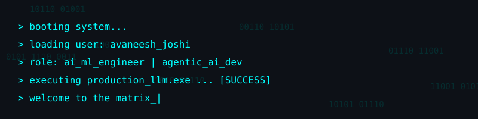

<p align="center">
  
</p>

<p align="center">
  <a href="https://linkedin.com/in/avaneeshjoshi18"></a>
  <a href="mailto:avaneeshjoshi18@gmail.com"></a>
  <a href="https://avaneeshportfolio.netlify.app"></a>
  <a href="https://github.com/Avaneesh635"></a>
</p>

---

### `whoami` // About Me
```python
#!/usr/bin/env python3
class AvaneeshJoshi:
    def __init__(self):
        self.role = "Backend Software Engineer | Python, Distributed Systems & Data Infrastructure"
        self.focus = ["Backend APIs", "Distributed Systems", "Data Infrastructure", "Deterministic Testing"]
        self.track_record = "Independently scoped, architected, and shipped 3+ production backend & automation services."
        self.open_source = "22 merged PRs as Collaborator & Core Contributor on E2E-Self-Heal."
        self.status = "Open to Full-Time Roles & Relocation"
```

---

### `~/projects` // Featured Builds
| Project | Architecture & Impact | Stack |
| :--- | :--- | :--- |
| 🧠 **DocOps** *(Stateful Retrieval & Semantic Caching API)* | Fault-tolerant FastAPI backend with a stateful execution graph (`retrieve → reason → verify`) that dynamically alters query strategies on validation failure, fronted by a Redis semantic cache over PostgreSQL (`pgvector` HNSW index) with strict I/O and prompt-injection guardrails. | `Python` `FastAPI` `PostgreSQL` `pgvector` `Redis` |
| 🌙 **Luna** *(Sandboxed Local IPC & Automation Engine)* | Offline-first desktop backend runtime with zero cloud dependency, gating OS-level file and calendar automation behind consent modals and an isolated `ContextBridge` IPC layer. | `TypeScript` `Electron` `Node.js` |
| ⚙️ **Automated Operations & Routing Pipeline** | Consolidated 5+ operational workflows into an event-driven routing pipeline, cutting manual processing time by ~70% (`2+ hrs` to `<5 min`) via automated classification and priority queues. | `n8n` `Webhooks` `REST APIs` |

---

### `sudo ./open_source.sh` // Contributions
**E2E-Self-Heal** *(Python, Playwright, Pydantic, structlog, pytest)*
*Collaborator & Core Contributor — 22 Merged PRs*
- **State Persistence (`SnapshotStore`):** Built persistent `SnapshotStore` with strict Pydantic schemas, `structlog` logging, and a custom exception hierarchy for deterministic runtime state (rated **"Core Feature"** by maintainer).
- **Sync/Async Network Interception (`MatchScorer`):** Engineered Playwright Mock Injector supporting sync/async runtimes via route interception, paired with a deterministic `MatchScorer` for network-mock replay (rated **"Core Feature"**).
- **Verification Gateways (`run_shadow()`):** Architected end-to-end replay orchestration (`run_shadow()`) and an offline verification gate executing deterministic state validation before patches hit live tests.
- **Automated Testing:** Authored 70+ unit and integration tests in `pytest` across CLI commands, selector verification, and sandboxed execution modules.
- [🔗 Repository: Lee-Dongwook/E2E-Self-Heal](https://github.com/Lee-Dongwook/E2E-Self-Heal)

---

### `nmap -sV skills.local` // Tech Stack
```bash
PORT        STATE    SERVICE
Languages   open     Python, TypeScript, SQL
Backend     open     FastAPI, Pydantic, AsyncIO, REST APIs, TCP/RESP Networking
Databases   open     PostgreSQL, pgvector (HNSW Indexing), Redis
Testing/Ops open     pytest, structlog, Git, GitHub Actions, n8n, Webhooks
```

---

### `cat ./certifications.txt` // Credentials
`🏅 AWS Certified Cloud Practitioner` • `🏅 Google Cloud Professional ML Engineer` • `🏅 Cisco Endpoint Security` • `🏅 Oracle Agentic AI`

<div align="center">
  
</div>
